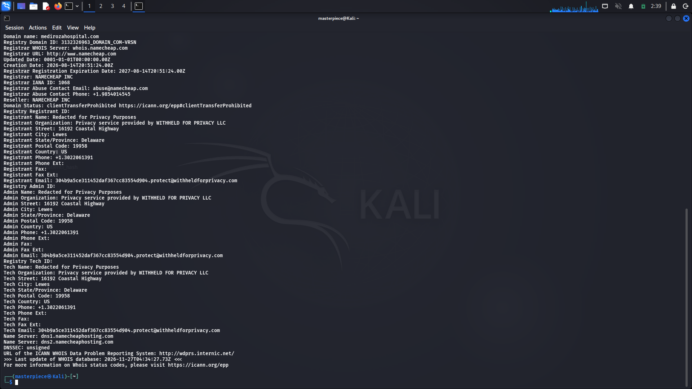
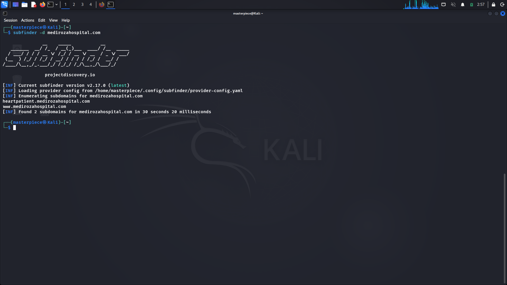
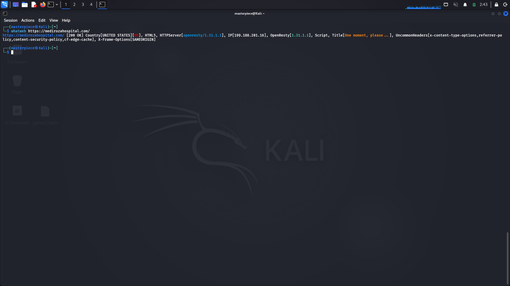
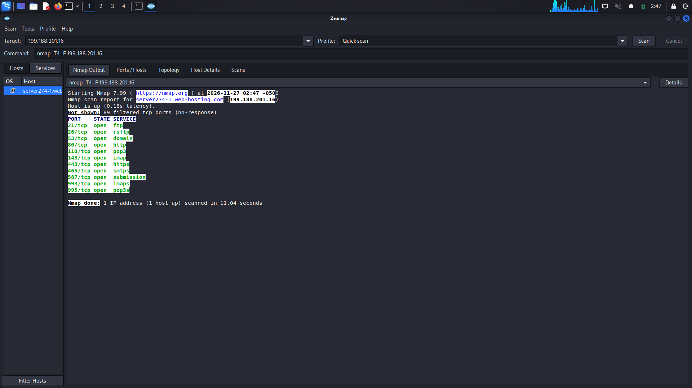
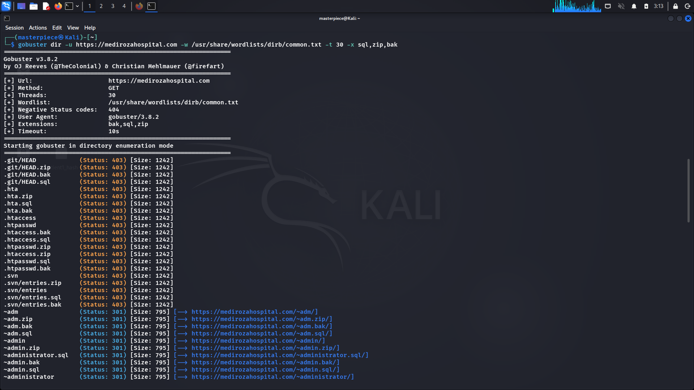
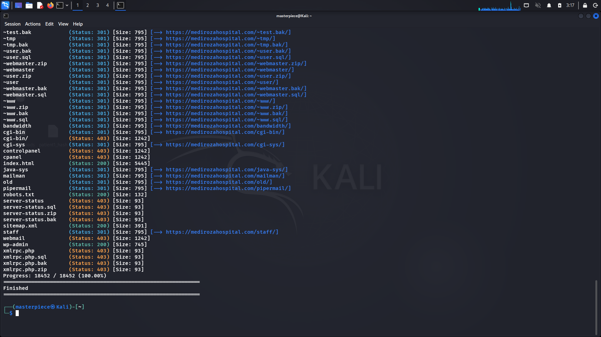
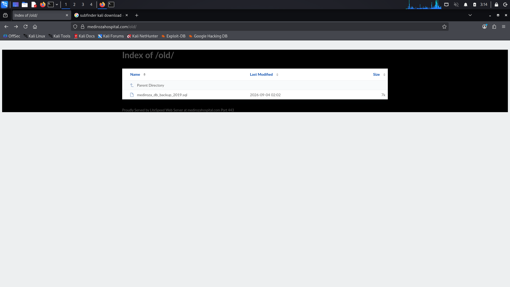
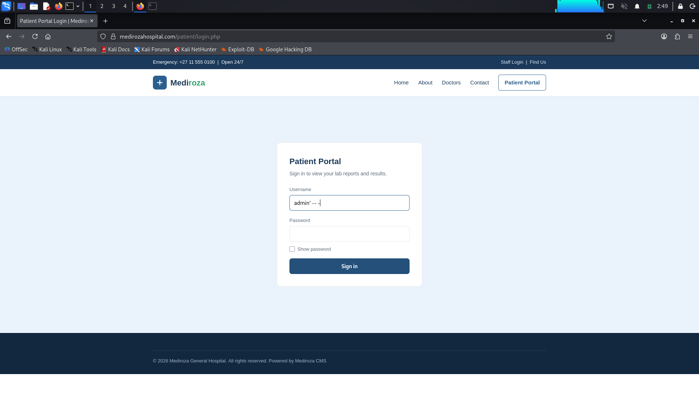
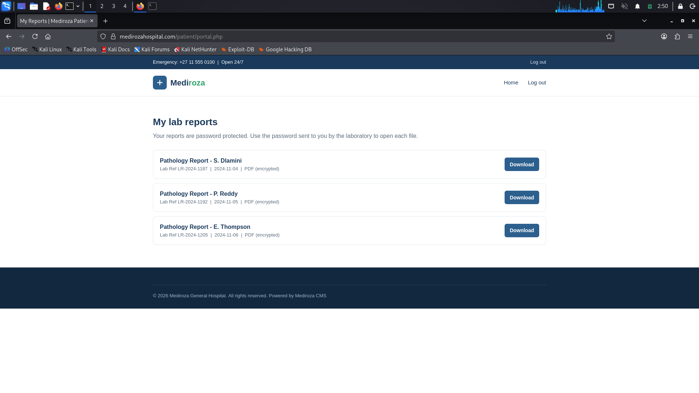

# Penetration Testing Report — Mediroza General Hospital

**NetworkWalks Cybersecurity Internship — Batch B084 — Week 4 Capstone**

- **Target:** `https://medirozahospital.com`
- **Assessment Type:** Black-box Penetration Test

> Conducted in a controlled training environment for educational purposes under written authorization. Public identification of the target is subject to permission to disclose the engagement.

## 1. Security Assessment

A Vulnerability Assessment and Penetration Testing (VAPT) exercise was performed against the authorized target as part of the Week 4 capstone project.

The assessment identified four findings, including three high-impact issues involving patient-portal authentication, exposure of a legacy database backup, and weak protection of patient pathology reports.

The SQL injection and exposed database backup represent two independent security issues.

## 2. Methodology & Tools

**Reconnaissance**
- `whois` — Domain registration information
- `subfinder` — Subdomain enumeration
- `whatweb` — Technology fingerprinting
- `Nmap` / `Zenmap` — Port and service scanning

**Enumeration & Exploitation**
- `gobuster` — Directory and file enumeration; identified the `/old/` directory
- Manual SQL injection testing — Patient portal authentication bypass
- Database backup analysis — Identification of exposed database information
- `pdfcrack` — Password recovery testing on retrieved PDF reports

Testing was conducted within the authorized assessment scope.

## 3. Evidence

> Screenshots included in this repository have been redacted to protect personal and confidential information.

1. WHOIS — 
2. Subfinder — 
3. WhatWeb — 
4. Nmap / Zenmap — 
5. Gobuster —  
6. /old/ directory discovered — 
7. SQL Injection — patient portal — 
8. Patient portal access — 

## 4. Key Findings

| ID | Finding | Severity |
|---|---|---|
| F1 | SQL Injection — Patient Portal Authentication Bypass | Critical* |
| F2 | Exposed Legacy Database Backup (`/old/`) | Critical* |
| F3 | Weakly Protected Patient Pathology Reports | Critical* |
| F4 | Information Disclosure / Enumeration Surface | Informational |

*Severity ratings are preliminary and should be supported by documented CVSS vectors before being presented as formal scores.*

**Privacy impact:** The exposed backup contained confidential staff personnel information and corporate ownership records. Retrieved patient PDF reports were protected by weak passwords, creating a risk of unauthorized access to confidential pathology information.

## 5. Recommendations

- Fix SQL injection vulnerabilities using parameterized queries and prepared statements.
- Remove publicly accessible backup files and disable directory indexing.
- Store database backups outside the web root with appropriate access controls and encryption.
- Replace weak PDF passwords with strong, randomly generated passphrases or authenticated download links.
- Review exposed administrative paths and legacy hosting aliases.
- Review mail and FTP services and disable unnecessary services or restrict access where appropriate.

## Conclusion

This assessment marks the completion of my Week 4 capstone project for the NetworkWalks Cybersecurity Internship, Batch B084.

The exercise provided practical experience in reconnaissance, enumeration, vulnerability identification, exploitation, evidence collection, and security reporting.
